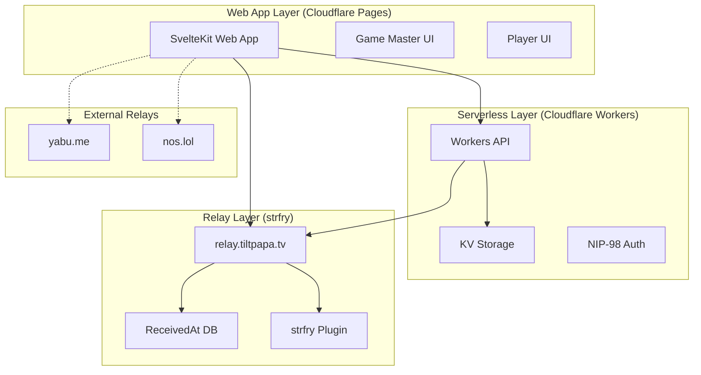

# 設計ドキュメント

## 概要

b-answerは、Nostrプロトコルを基盤とした分散型リアルタイムクイズシステムです。制限時間付きの択一クイズを出題・回答・集計する機能を提供し、高精度な時刻管理と暗号化による回答保護を実現します。システムは3つの主要コンポーネント（Nostrリレー、Cloudflare Workers/KV、SvelteKit Webアプリ）で構成され、スケーラブルで高可用性なアーキテクチャを採用しています。

## アーキテクチャ

### システム全体構成



### データフロー

1. **問題出題フロー**: Game Master → Web App → Nostr Relay → Players
2. **回答フロー**: Player → Web App → Nostr Relay → Game Master
3. **時刻管理フロー**: Nostr Relay → strfry Plugin → ReceivedAt DB → Workers → Web App
4. **鍵管理フロー**: Web App → Workers → KV Storage

## コンポーネントとインターフェース

### 1. Nostrリレー部（strfry）

**責任範囲:**
- Nostrプロトコルに基づくイベント配信
- 高精度なReceivedAt時刻記録
- イベントの永続化と検索

**主要インターフェース:**
- WebSocket接続（Nostrプロトコル）
- HTTP API（ReceivedAt取得用）
- LMDB データベース

**strfryプラグイン仕様:**
```cpp
// ReceivedAt記録用プラグイン
struct ReceivedAtRecord {
    std::string event_id;
    uint64_t received_at_microsec;
    std::vector<std::string> p_tags;
    std::vector<std::string> e_tags;
};
```

### 2. Cloudflare Workers部

**責任範囲:**
- NIP-98認証処理
- 暗号化鍵の生成・管理
- ReceivedAt時刻の取得・提供

**主要API:**
```typescript
interface WorkersAPI {
  // NIP-98認証
  authenticate(request: Request): Promise<{
    isValid: boolean;
    pubkey?: string;
    error?: string;
  }>;
  
  // 回答鍵管理（1ゲーム共通方式、プレイヤーごとに個別生成）
  generateAnswerKey(gameId: string, playerId: string): Promise<{
    keyId: string;
    success: boolean;
  }>;
  getAnswerKey(gameId: string, playerId: string): Promise<{
    key?: string; // base64エンコード
    error?: string;
  }>;
  getAllAnswerKeys(gameId: string, requesterId: string): Promise<{
    keys?: Record<string, string>; // playerId -> base64 key
    error?: string;
  }>;
  
  // 問題鍵管理（非公開ゲーム用）
  generateQuestionKey(gameId: string, authorizedUsers: string[]): Promise<{
    keyId: string;
    success: boolean;
  }>;
  getQuestionKey(gameId: string, requesterId: string): Promise<{
    key?: string; // base64エンコード
    error?: string;
  }>;
  
  // ReceivedAt時刻取得
  getReceivedAt(eventIds: string[]): Promise<{
    timestamps: Record<string, {
      receivedAt: number; // マイクロ秒精度のUnixタイムスタンプ
      pTags?: string[];   // 関連pタグ
      eTags?: string[];   // 関連eタグ
    }>;
    errors?: Record<string, string>;
  }>;
}
```

### 3. SvelteKit Webアプリ部

**責任範囲:**
- ユーザーインターフェース
- Nostr通信の管理
- 暗号化・復号処理

**主要コンポーネント:**
```typescript
// Game Master UI（TweetDeck風マルチカラム）
interface GameMasterInterface {
  // 問題作成・管理
  createQuestion(question: Question): Promise<{eventId: string}>;
  saveDraft(question: Question, folderId?: string): Promise<{eventId: string}>;
  loadDraft(eventId: string): Promise<Question>;
  exportScript(questions: Question[]): Promise<string>; // Markdown台本
  
  // 出題制御
  publishQuestion(questionId: string, delay?: number): Promise<{eventId: string}>;
  sendSecondsLeft(startEventId: string, seconds: number): Promise<void>;
  endQuestion(startEventId: string): Promise<void>;
  previewQuestion(question: Question): Promise<void>; // ディレイ無視
  
  // 回答監視・集計
  monitorAnswers(startEventId: string): Promise<PlayerScore[]>;
  getAnswerCount(startEventId: string): Promise<number[]>; // 選択肢別回答数
  calculateResults(startEventId: string): Promise<PlayerScore[]>;
  publishResults(startEventId: string, results: PlayerScore[]): Promise<void>;
  
  // ピリオド・ゲーム管理
  startPeriod(periodId: string, revival: boolean): Promise<{eventId: string}>;
  endPeriod(periodStartEventId: string): Promise<PeriodResults>;
  eliminatePlayer(playerId: string, reason: string, questionEventId: string): Promise<void>;
  declareChampion(playerId: string, type: "period" | "final", eventId: string): Promise<void>;
  
  // ランキング・成績管理
  publishRanking(data: RankingData): Promise<void>;
  savePlayerScore(score: PlayerScore): Promise<void>;
  savePeriodResults(results: PeriodResults): Promise<void>;
  saveTotalResults(results: TotalResults): Promise<void>;
  
  // プレイヤー管理
  setAnswerPermission(playerId: string, allowed: boolean): Promise<void>;
  adjustScore(playerId: string, points: number): Promise<void>;
  
  // ボーナスクイズ
  startBonusQuiz(periodEventId: string, question: Question): Promise<void>;
  handleBonusAnswer(playerId: string, answer: number[]): Promise<void>;
}

// Player UI（レスポンシブ、3:4問題表示部 + 6色回答ボタン）
interface PlayerInterface {
  // ゲーム参加
  joinGame(gameId: string): Promise<{answerKey: string}>;
  getGameList(): Promise<{public: GameInfo[], joined: GameInfo[]}>;
  
  // 問題受信・回答
  subscribeToQuestions(gameId: string): Promise<void>;
  receiveQuestion(): Promise<PublishedQuestion>;
  submitAnswer(startEventId: string, answerIndex: number): Promise<void>;
  
  // 結果確認
  viewResults(startEventId: string): Promise<PlayerScore>;
  viewRanking(gameId: string): Promise<RankingData>;
  viewPeriodResults(periodId: string): Promise<PeriodResults>;
  viewTotalResults(gameId: string): Promise<TotalResults>;
  
  // UI制御
  showShutterEffect(): void; // 回答権なし時
  handleKeyboardInput(key: '1'|'2'|'3'|'4'|'5'|'6'): void;
}
```

## データモデル

### Nostrイベント定義

```typescript
// 共通クライアントタグ
interface CommonTags {
  client: ["client", "b-answer", "31990:tiltpapa-pubkey:b-answer", "wss://relay.b-answer.tiltpapa.tv"];
}

// Game Master Profile (kind: 0)
interface GameMasterProfile {
  kind: 0;
  content: string; // JSON: {name: string, about: string, website?: string}
  tags: CommonTags["client"][];
}

// Player Profile (kind: 30078, d: "banswer-profile")
interface PlayerProfile {
  kind: 30078;
  tags: [
    ["d", "banswer-profile"],
    ["p", string], // Game Master ID (参加履歴)
    ...CommonTags["client"]
  ];
  content: string; // JSON: {name: string, pronunciation?: string, eula: string | false}
}

// 下書き問題 (kind: 78, d: "banswer-draft")
interface DraftQuestion {
  kind: 78;
  tags: [
    ["d", "banswer-draft"],
    ["a", string], // Display Format event
    ...CommonTags["client"]
  ];
  content: string; // Encrypted Question JSON (NIP-04)
}

// 下書きフォルダ (kind: 30078, d: "banswer-folder/<folder name>")
interface DraftFolder {
  kind: 30078;
  tags: [
    ["d", string], // "banswer-folder/<folder name>"
    ["p", string], // Game Master pubkey
    ["e", string], // Draft Question id
    ...CommonTags["client"]
  ];
  content: string;
}

// 問題出題イベント (kind: 78, d: "start")
interface StartEvent {
  kind: 78;
  tags: [
    ["d", "start"],
    ["a", string], // Display Format event
    ["p", string], // Player pubkey (optional, 回答権制限用)
    ...CommonTags["client"]
  ];
  content: string; // Question JSON (answerフィールド除く、非公開ゲームでは暗号化)
}

// 残り時間通知 (kind: 20078, d: "banswer-left")
interface SecondsLeftEvent {
  kind: 20078;
  tags: [
    ["d", "banswer-left"],
    ["e", string], // Start event ID
    ...CommonTags["client"]
  ];
  content: string; // 残り秒数
}

// 問題終了 (kind: 78, d: "banswer-end")
interface EndEvent {
  kind: 78;
  tags: [
    ["d", "banswer-end"],
    ["e", string], // Start event ID
    ...CommonTags["client"]
  ];
  content: "End";
}

// 回答数チェック (kind: 78, d: "banswer-answer-check")
interface AnswerCheckEvent {
  kind: 78;
  tags: [
    ["d", "banswer-answer-check"],
    ["e", string], // Start event ID
    ...CommonTags["client"]
  ];
  content: string; // JSON array: [number, number, ...] 各選択肢の回答者数
}

// プレイヤー回答 (kind: 78, d: "banswer-answer")
interface PlayerAnswerEvent {
  kind: 78;
  tags: [
    ["d", "banswer-answer"],
    ["e", string], // Start event ID
    ...CommonTags["client"]
  ];
  content: string; // 暗号化された回答 (Answer_Keyで暗号化)
}

// 正解発表 (kind: 78, d: "banswer-answer")
interface CorrectAnswerEvent {
  kind: 78;
  tags: [
    ["d", "banswer-answer"],
    ["e", string], // Start event ID
    ...CommonTags["client"]
  ];
  content: string; // Question.answerフィールドのJSON
}

// 成績記録 (kind: 30078, d: "banswer-score/<gameId>")
interface ScoreRecord {
  kind: 30078;
  tags: [
    ["d", string], // "banswer-score/<gameId>"
    ["p", string], // Game Master pubkey
    ["e", string], // Start event ID (問題ごと)
    ...CommonTags["client"]
  ];
  content: string; // JSON: PlayerScore
}

// ピリオド成績 (kind: 30078, d: "banswer-period/<gameId>/<periodId>")
interface PeriodScore {
  kind: 30078;
  tags: [
    ["d", string], // "banswer-period/<gameId>/<periodId>"
    ["p", string], // Game Master pubkey
    ...CommonTags["client"]
  ];
  content: string; // JSON: PeriodResults
}

// 総合成績 (kind: 30078, d: "banswer-total/<gameId>")
interface TotalScore {
  kind: 30078;
  tags: [
    ["d", string], // "banswer-total/<gameId>"
    ["p", string], // Game Master pubkey
    ...CommonTags["client"]
  ];
  content: string; // JSON: TotalResults
}

// ランキング発表 (kind: 78, d: "banswer-ranking")
interface RankingEvent {
  kind: 78;
  tags: [
    ["d", "banswer-ranking"],
    ["p", string], // Game Master pubkey
    ["e", string], // 関連する問題またはピリオドのevent ID
    ...CommonTags["client"]
  ];
  content: string; // JSON: RankingData
}

// 予選落ち通知 (kind: 78, d: "banswer-elimination")
interface EliminationEvent {
  kind: 78;
  tags: [
    ["d", "banswer-elimination"],
    ["e", string], // Start event ID
    ["p", string], // 脱落プレイヤーのpubkey
    ...CommonTags["client"]
  ];
  content: string; // JSON: {reason: "slowest_correct" | "incorrect", time?: number}
}

// チャンピオン決定 (kind: 78, d: "banswer-champion")
interface ChampionEvent {
  kind: 78;
  tags: [
    ["d", "banswer-champion"],
    ["p", string], // チャンピオンのpubkey
    ["e", string], // 関連するピリオドまたは問題のevent ID
    ...CommonTags["client"]
  ];
  content: string; // JSON: {type: "period" | "final", score: number, time: number}
}

// ボーナスクイズ開始 (kind: 78, d: "banswer-bonus")
interface BonusQuizEvent {
  kind: 78;
  tags: [
    ["d", "banswer-bonus"],
    ["e", string], // 関連するピリオドのevent ID
    ...CommonTags["client"]
  ];
  content: string; // 並べ替え問題のJSON
}

// ピリオド開始 (kind: 78, d: "banswer-period-start")
interface PeriodStartEvent {
  kind: 78;
  tags: [
    ["d", "banswer-period-start"],
    ["p", string], // Game Master pubkey
    ...CommonTags["client"]
  ];
  content: string; // JSON: {periodId: string, revival: boolean}
}

// ピリオド終了 (kind: 78, d: "banswer-period-end")
interface PeriodEndEvent {
  kind: 78;
  tags: [
    ["d", "banswer-period-end"],
    ["e", string], // Period start event ID
    ...CommonTags["client"]
  ];
  content: string; // JSON: {periodId: string, nextPeriod?: string}
}
```

### 問題データ構造（format.md準拠）

```typescript
interface Question {
  type: "choice" | "sort" | "bonus" | "point";
  question: {
    type: "text" | "image";
    content: string; // テキストまたは画像リンク
  };
  choices: Array<{
    type: "text" | "image";
    content: string; // テキストまたは画像リンク
    explanation: string; // 選択肢の解説
  }>;
  answer: number[]; // 正解の選択肢番号配列 (1-based indexing)
  total: number;    // 選択肢の総数 (1以上)
  required: number; // 正解として必要な選択肢数 (totalまで)
  point: number;    // この問題の得点
  prize: {
    type: "single" | "split";
    price: number;
  };
  version: string;  // フォーマットバージョン
}

// 出題時用（answerフィールドを除いた問題）
interface PublishedQuestion extends Omit<Question, 'answer'> {
  // answerフィールドは除外される
}

// プレイヤー成績データ
interface PlayerScore {
  playerId: string;        // Player pubkey
  playerName: string;      // 表示名
  questionId: string;      // 問題のevent ID
  answer: number[];        // 回答した選択肢
  isCorrect: boolean;      // 正誤
  responseTime: number;    // 回答時間（マイクロ秒）
  points: number;          // 獲得得点
  timestamp: number;       // 回答時刻
}

// ピリオド結果データ
interface PeriodResults {
  periodId: string;
  gameId: string;          // Game Master pubkey
  players: Array<{
    playerId: string;
    playerName: string;
    totalPoints: number;
    totalTime: number;      // 合計回答時間
    correctAnswers: number;
    questionsAnswered: number;
    rank: number;
    isEliminated: boolean;
    eliminationReason?: string;
  }>;
  champion?: {
    playerId: string;
    playerName: string;
    criteria: "fastest_correct" | "most_correct_fastest";
  };
  hasBonus: boolean;
  bonusWinner?: string;    // ボーナスクイズ勝者
}

// 総合結果データ
interface TotalResults {
  gameId: string;          // Game Master pubkey
  periods: string[];       // ピリオドID配列
  finalRanking: Array<{
    playerId: string;
    playerName: string;
    totalPoints: number;
    totalTime: number;
    periodsWon: number;
    finalRank: number;
  }>;
  gameWinner: {
    playerId: string;
    playerName: string;
  };
}

// ランキング表示データ
interface RankingData {
  type: "elimination" | "champion" | "period" | "total";
  displayMode: "top_n" | "bottom_n" | "range";
  showPoints: boolean;
  showTime: boolean;
  players: Array<{
    playerId: string;
    playerName: string;
    rank: number;
    points?: number;
    time?: number;        // コンマ2桁まで表示
    status?: "eliminated" | "champion" | "active";
  }>;
  revealOrder?: "sequential" | "simultaneous" | "last_two_together";
}
```

### 暗号化鍵管理

```typescript
interface KeyManagement {
  // 回答鍵（プレイヤー用）- 1ゲーム共通方式、プレイヤーごとに個別生成
  answerKeys: Map<string, {
    gameId: string;      // Game Master pubkey
    playerId: string;    // Player pubkey
    key: Uint8Array;     // 32バイト暗号化鍵
    createdAt: number;   // 生成時刻
    expiresAt: number;   // 有効期限
  }>;
  
  // 問題鍵（非公開ゲーム用）- 主催者と参加プレイヤーが共有
  questionKeys: Map<string, {
    gameId: string;           // Game Master pubkey
    key: Uint8Array;          // 32バイト暗号化鍵
    authorizedUsers: string[]; // 主催者 + 参加プレイヤーのpubkey配列
    createdAt: number;        // 生成時刻
    isPrivateGame: boolean;   // 非公開ゲームフラグ
  }>;
}

// Cloudflare KV保存形式
interface KVStoredKey {
  keyType: "answer" | "question";
  gameId: string;
  playerId?: string; // answer keyの場合のみ
  encryptedKey: string; // base64エンコードされた暗号化鍵
  metadata: {
    createdAt: number;
    expiresAt?: number;
    authorizedUsers?: string[];
  };
}
```

## 正確性プロパティ

*プロパティとは、システムの全ての有効な実行において真であるべき特性や動作のことです。プロパティは、人間が読める仕様と機械で検証可能な正確性保証の橋渡しとなります。*

### プロパティ 1: 鍵生成の独立性
*任意の* Game_Masterアカウント作成において、生成されるNostr秘密鍵は既存の鍵と重複せず、有効なsecp256k1鍵である
**検証対象: 要件 1.1**

### プロパティ 2: 問題データの完全性
*任意の* 問題作成において、保存される問題データは入力された全ての必須フィールド（タイトル、問題文、選択肢、正解、解説）を含む
**検証対象: 要件 1.2**

### プロパティ 3: 問題配信の時刻制約
*任意の* 問題出題において、生成されるNostrイベントは指定された制限時間情報を含み、配信時刻が記録される
**検証対象: 要件 1.3**

### プロパティ 4: 集計結果の正確性
*任意の* 回答集計において、生成されるランキングは全プレイヤーの回答時刻と正誤判定に基づいて正しく計算される
**検証対象: 要件 1.4**

### プロパティ 5: 結果配信の完全性
*任意の* 結果発表において、配信される情報は正解、解説、ランキングの全てを含む
**検証対象: 要件 1.5**

### プロパティ 6: Answer_Key生成の独立性
*任意の* プレイヤーのゲーム参加において、生成されるAnswer_Keyは既存のNostr秘密鍵とは独立し、ゲーム固有である
**検証対象: 要件 2.1**

### プロパティ 7: 問題受信の完全性
*任意の* 問題受信において、表示される情報は問題文、選択肢、制限時間の全てを含む
**検証対象: 要件 2.2**

### プロパティ 8: 回答暗号化の正確性
*任意の* 回答送信において、生成されるNostrイベントはAnswer_Keyで正しく暗号化された回答を含む
**検証対象: 要件 2.3**

### プロパティ 9: 時刻記録の精度
*任意の* 制限時間内回答において、記録されるReceivedAtは実際の到達時刻をマイクロ秒精度で表現する
**検証対象: 要件 2.4**

### プロパティ 10: 結果表示の正確性
*任意の* プレイヤー結果確認において、表示される情報は該当プレイヤーの回答、正解、順位、得点を正確に反映する
**検証対象: 要件 2.5**

### プロパティ 11: イベント記録の完全性
*任意の* Nostrイベント到達において、専用データベースにはイベントIDとReceivedAtが確実に記録される
**検証対象: 要件 3.1**

### プロパティ 12: ReceivedAt取得の正確性
*任意の* ReceivedAt要求において、返却される値は指定されたイベントIDに対応する正確な時刻である
**検証対象: 要件 3.2**

### プロパティ 13: 同時イベントの時刻区別
*任意の* 同時到達イベント群において、各イベントのReceivedAtはマイクロ秒精度で区別可能である
**検証対象: 要件 3.3**

### プロパティ 14: 関連イベント記録の完全性
*任意の* pタグまたはeタグを含むイベントにおいて、関連イベントIDも併せて記録される
**検証対象: 要件 3.4**

### プロパティ 15: Answer_Key管理の正確性
*任意の* ゲーム開始において、各プレイヤー用のAnswer_KeyがCloudflare KVに正しく生成・保存される
**検証対象: 要件 4.1**

### プロパティ 16: Question_Key配布の正確性
*任意の* 非公開ゲーム作成において、Question_Keyは主催者と参加プレイヤーのみが取得可能である
**検証対象: 要件 4.2**

### プロパティ 17: 回答暗号化ラウンドトリップ
*任意の* プレイヤー回答において、Answer_Keyで暗号化してからGame_Masterが復号した結果は元の回答と一致する
**検証対象: 要件 4.3, 4.4**

### プロパティ 18: 問題暗号化ラウンドトリップ
*任意の* 非公開ゲーム問題において、Question_Keyで暗号化してからプレイヤーが復号した結果は元の問題と一致する
**検証対象: 要件 4.5**

### プロパティ 19: NIP-98認証の強制
*任意の* WorkersへのAPIリクエストにおいて、有効なNIP-98認証なしではアクセスが拒否される
**検証対象: 要件 5.1, 5.3**

### プロパティ 20: 認証成功時の処理実行
*任意の* 有効なNIP-98認証を含むリクエストにおいて、要求された操作が正常に実行される
**検証対象: 要件 5.2**

### プロパティ 21: 鍵管理アクセス制御
*任意の* 鍵管理操作において、認証されたユーザーのみがアクセス可能である
**検証対象: 要件 5.4**

### プロパティ 22: レスポンシブレイアウト適応
*任意の* デバイスサイズにおいて、Web_Appは適切なレスポンシブレイアウトを表示する
**検証対象: 要件 6.1**

### プロパティ 23: 回答権制御の正確性
*任意の* 回答権なし状態において、シャッター演出が表示され回答ボタンが無効化される
**検証対象: 要件 6.4**

### プロパティ 24: キーボード操作の対応
*任意の* 1-6キー入力において、対応する回答ボタンが操作される
**検証対象: 要件 6.5**

### プロパティ 25: 問題管理機能の提供
*任意の* Game_Master問題管理において、下書きフォルダ機能と簡易台本出力機能が利用可能である
**検証対象: 要件 7.1**

### プロパティ 26: リアルタイム監視の正確性
*任意の* 回答状況変化において、Game_Masterにリアルタイムでプレイヤー別回答状況が表示される
**検証対象: 要件 7.2**

### プロパティ 27: 得点計算の正確性
*任意の* 得点管理において、ピリオド別・総合得点が正確に自動計算され、手動調整も可能である
**検証対象: 要件 7.3**

### プロパティ 28: 回答権制御の即時性
*任意の* 回答権制御において、個別プレイヤーの回答権が即座に有効・無効に切り替わる
**検証対象: 要件 7.4**

### プロパティ 29: プレビューのディレイ無視
*任意の* Game_Masterプレビュー実行において、送信ディレイが無視され即座に問題が表示される
**検証対象: 要件 7.5**

### プロパティ 30: 冗長保存の実行
*任意の* プロフィール・下書き・成績データ作成において、メインリレーと冗長保存リレーの両方に保存される
**検証対象: 要件 8.1, 8.2, 8.3**

### プロパティ 31: フェイルオーバーの自動実行
*任意の* メインリレー障害において、冗長保存リレーから自動的にデータが取得される
**検証対象: 要件 8.4**

### プロパティ 32: XSS防止の完全性
*任意の* ユーザー入力（問題文、選択肢、プレイヤー名、解説文）において、悪意のあるスクリプトが適切にサニタイズ・エスケープされる
**検証対象: 要件 9.1, 9.2, 9.3, 9.4**

### プロパティ 33: 自動デプロイの正確性
*任意の* ブランチプッシュにおいて、ブランチ名に基づいた適切なサブディレクトリにデプロイされる
**検証対象: 要件 10.2**

## エラーハンドリング

### 1. Nostrリレー障害対応

```typescript
class RelayFailureHandler {
  private fallbackRelays: string[] = ['yabu.me', 'nos.lol'];
  
  async handleRelayFailure(primaryRelay: string): Promise<void> {
    // 自動フェイルオーバー
    for (const relay of this.fallbackRelays) {
      try {
        await this.connectToRelay(relay);
        break;
      } catch (error) {
        console.warn(`Fallback relay ${relay} failed:`, error);
      }
    }
  }
}
```

### 2. 暗号化エラー対応

```typescript
class CryptographyErrorHandler {
  async handleDecryptionFailure(encryptedData: string, keyId: string): Promise<void> {
    // 鍵の再取得を試行
    const newKey = await this.refreshKey(keyId);
    if (newKey) {
      return this.decrypt(encryptedData, newKey);
    }
    throw new Error('Decryption failed: Invalid key');
  }
}
```

### 3. 時刻同期エラー対応

```typescript
class TimeSyncErrorHandler {
  async handleTimeSyncFailure(): Promise<void> {
    // NTPサーバーとの時刻同期
    const ntpTime = await this.getNTPTime();
    const localTime = Date.now();
    this.timeOffset = ntpTime - localTime;
  }
}
```

## テスト戦略

### 単体テスト

単体テストは特定の例、エッジケース、エラー条件を検証します：

- **暗号化・復号機能**: 既知のテストベクターを使用
- **Nostrイベント生成**: 仕様準拠の検証
- **UI コンポーネント**: ユーザー操作のシミュレーション
- **API エンドポイント**: 認証とレスポンス形式の検証

### プロパティベーステスト

プロパティベーステストは、全ての入力に対して成り立つべき普遍的なプロパティを検証します。**fast-check**ライブラリを使用し、各テストは最低100回の反復実行を行います。

各プロパティベーステストには、設計ドキュメントの対応するプロパティを明示的に参照するコメントを付与します：

```typescript
// **Feature: b-answer-quiz-system, Property 17: 回答暗号化ラウンドトリップ**
```

**テスト対象プロパティ:**
- 鍵生成の独立性と有効性
- 暗号化・復号のラウンドトリップ
- 時刻記録の精度と一意性
- データ保存の完全性
- 認証とアクセス制御
- UI状態の一貫性
- エラーハンドリングの適切性

### 統合テスト

- **エンドツーエンドゲームフロー**: 問題作成から結果発表まで
- **マルチプレイヤーシナリオ**: 同時回答の処理
- **障害復旧テスト**: リレー障害時のフェイルオーバー
- **パフォーマンステスト**: 大量プレイヤーでの負荷テスト

### テスト環境

```typescript
// テスト用設定
interface TestEnvironment {
  relays: {
    primary: 'ws://localhost:7777';
    fallback: ['ws://localhost:7778', 'ws://localhost:7779'];
  };
  workers: {
    endpoint: 'http://localhost:8787';
  };
  kv: {
    namespace: 'TEST_KV';
  };
}
```